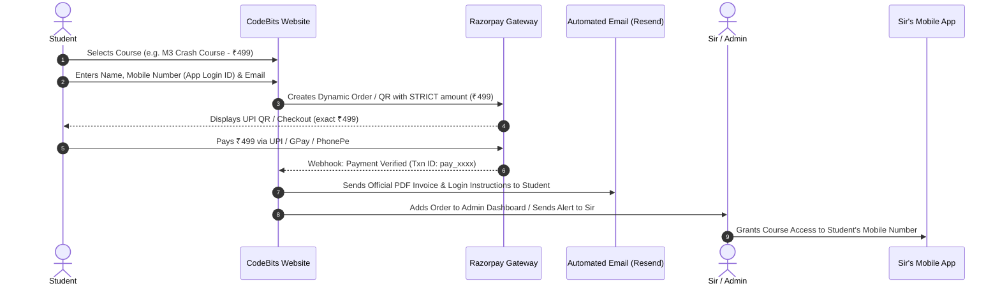

# CodeBits Course Sales, Invoicing & App Access Architecture
**Prepared for:** Prof. Rohit Falake (M.R.F) & Rehan Ansari  
**Platform:** CodeBits Web Platform & Ecosystem  
**Document Version:** 1.0.0 (Production Roadmap)

---

## 1. Executive Summary & Vision
CodeBits serves as the primary **web-based academic hub, course discovery catalog, and payment collection gateway**. 

Sir already operates a dedicated mobile application with DRM protection where video lectures are hosted. Rather than incurring heavy video hosting and streaming bandwidth costs on CodeBits, the website acts as the **high-converting web funnel, dynamic payment processor, automated invoice generator, and order dispatch console**.



---

## 2. Cost Analysis for Sir

| Component | Provider | Upfront Cost | Running Cost | Notes |
| :--- | :--- | :--- | :--- | :--- |
| **Course Catalog & Funnel** | CodeBits Next.js (Vercel) | **₹0** | **₹0** | Existing high-performance deployment. |
| **Database & Orders** | MongoDB Atlas | **₹0** | **₹0** | M0 free cluster stores millions of order records. |
| **Payment Gateway** | Razorpay / Cashfree | **₹0** | **~2% per transaction** | Deducted automatically only when students pay. Zero monthly rent or setup fee. |
| **Automated Invoices** | Resend / Nodemailer | **₹0** | **₹0** | Free tier includes up to 3,000 emails/month. |
| **Video Hosting** | Sir's Existing Mobile App | **₹0** | **₹0 additional** | Already handled on Sir's app infrastructure. |
| **Total Cost for Sir** | | **₹0 Upfront** | **~2% per sale** | **~98% pure profit margin** on every course sold. |

---

## 3. Core Architecture & Workflow

### 3.1 Step 1: Course Catalog & Selection
- Public catalog on CodeBits (`/courses` or `/lectures?tab=courses`).
- Filterable by **University** (Mumbai University, SPPU Pune, DBATU, Autonomous), Branch, and Semester.
- Cards show:
  - Subject Name (e.g., *Applied Mathematics III - Complete Exam Preparation*)
  - Faculty (*Prof. Rohit Falake / M.R.F*)
  - Included Highlights: Full syllabus video roadmap, formula sheets, solved 5-year question papers, exam revision notes.
  - Price Tag: e.g. `₹499` (Special discount badge).

### 3.2 Step 2: Checkout & Strict Amount Locking
- Student clicks **"Enroll Now"**.
- Checkout modal collects student verification:
  - **Full Name**
  - **Registered Mobile Number** *(Explicitly labeled: "Enter the mobile number you use to log into Sir MRF's App")*.
  - **Email Address** *(For invoice delivery)*.
  - **College / Branch / Semester**
- Frontend calls `/api/payments/create-order`.
- Razorpay order is initialized with the exact integer amount in paise (e.g., `49900`).
- Student scans the dynamic UPI QR code or uses GPay / PhonePe / Paytm / Card.
- **Strict Validation:** The payment gateway strictly enforces that only the exact order amount can be paid.

### 3.3 Step 3: Webhook Verification & Invoice Generation
- On successful payment, Razorpay sends a signed webhook (`razorpay_signature`) to `/api/payments/verify`.
- Backend verifies HMAC SHA-256 signature to guarantee zero tampering or fake payments.
- Order record is created in MongoDB:
  ```json
  {
    "_id": "67b0f...",
    "orderId": "cb_ord_20261017_0042",
    "razorpayPaymentId": "pay_PqR987xyz",
    "student": {
      "name": "Amit Sharma",
      "phone": "9820012345",
      "email": "amit.sharma@gmail.com",
      "college": "VESIT Chembur",
      "branch": "COMPS",
      "semester": 3
    },
    "course": {
      "id": "course-m3-crash",
      "title": "Applied Mathematics III Fast-Track",
      "price": 499
    },
    "status": "PAID",
    "appAccessStatus": "PENDING_ACTIVATION",
    "paidAt": "2026-10-17T22:30:00Z"
  }
  ```
- **Automated Tax Invoice Generation**:
  - CodeBits generates a PDF receipt with serial number `CB-INV-2026-0042`, payment ID, date, student details, and GST/PAN breakdown.
  - Delivered instantly to the student's email with the message:
    > *"Thank you for enrolling! Your course access inside the Sir MRF mobile application is being activated for registered mobile number **+91 9820012345** within 15–30 minutes."*

### 3.4 Step 4: Admin Fulfillment Console (`/admin/orders`)
- Sir or Admin logs into CodeBits Admin Console (`CODEBITS` / `codebits@mrf`).
- A dedicated **"Course Orders"** dashboard displays:
  - Live feed of all paid orders.
  - One-click copy for the student's mobile number.
  - Status toggle: `🟡 Pending Activation` ➔ `🟢 Activated in App`.
  - Filter by date, course, or pending status.
  - (Optional Future Automation): If Sir's app provider (Classplus, Teachmint, etc.) provides a webhook or Admin API, CodeBits can automatically call their API to grant access instantly with zero manual clicks.

---

## 4. Multi-University Expansion Roadmap

To support universities beyond Mumbai University (e.g., SPPU / Pune, DBATU, Autonomous Colleges):

1. **Global University Switcher:**
   - Add a university selector in the top navigation bar (`MU`, `SPPU`, `DBATU`, `AUTONOMOUS`).
   - Persisted in user preferences / `localStorage`.
2. **Schema Generalization:**
   - Update `Resource` and `Course` schemas to include `university: { type: String, default: "MU" }`.
   - Existing Mumbai University queries remain completely unaffected (`university: "MU"` by default).
3. **Branch & Scheme Mapping:**
   - Autonomous colleges (e.g. VJTI, SPIT, DJ Sanghvi) follow custom credit schemes. A centralized configuration maps branches and semesters per university.

---

## 5. Phased Implementation Timeline

| Phase | Milestone | Deliverables |
| :--- | :--- | :--- |
| **Phase 1** | **Foundation (Completed)** | Free Vault, AI Solver, Document Converter, YouTube Lectures & Live Streams with Admin Console. |
| **Phase 2** | **Course Catalog & Multi-University UI** | University selector (MU / SPPU / DBATU) + Course showcase pages with syllabus outlines. |
| **Phase 3** | **Razorpay & Invoicing** | Dynamic UPI QR checkout, Resend email invoice generator, and `/admin/orders` fulfillment dashboard. |

---
*Authored by Team CodeBits & Antigravity IDE*
